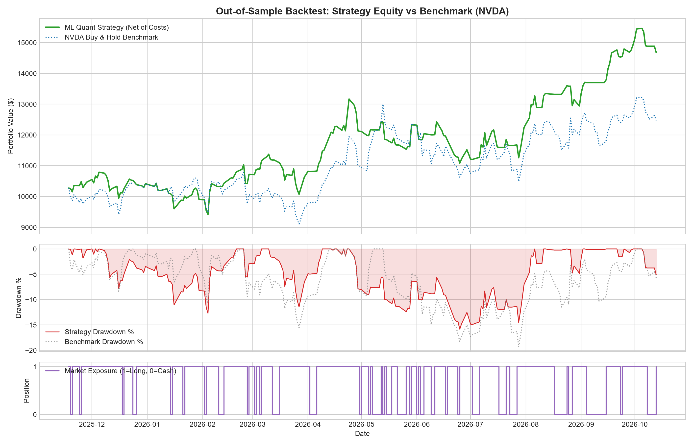
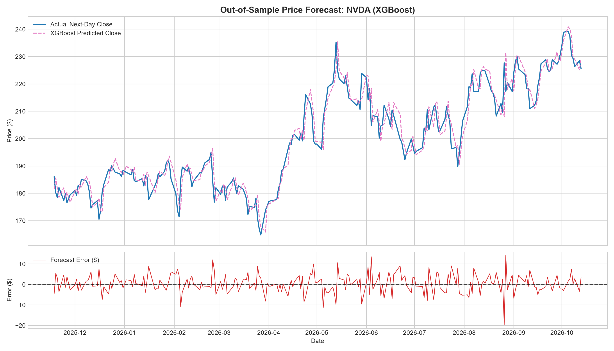
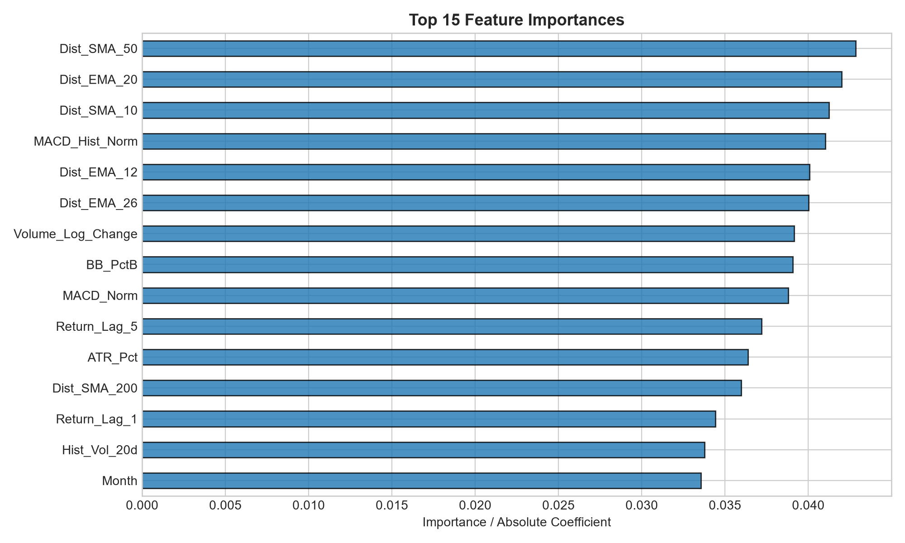
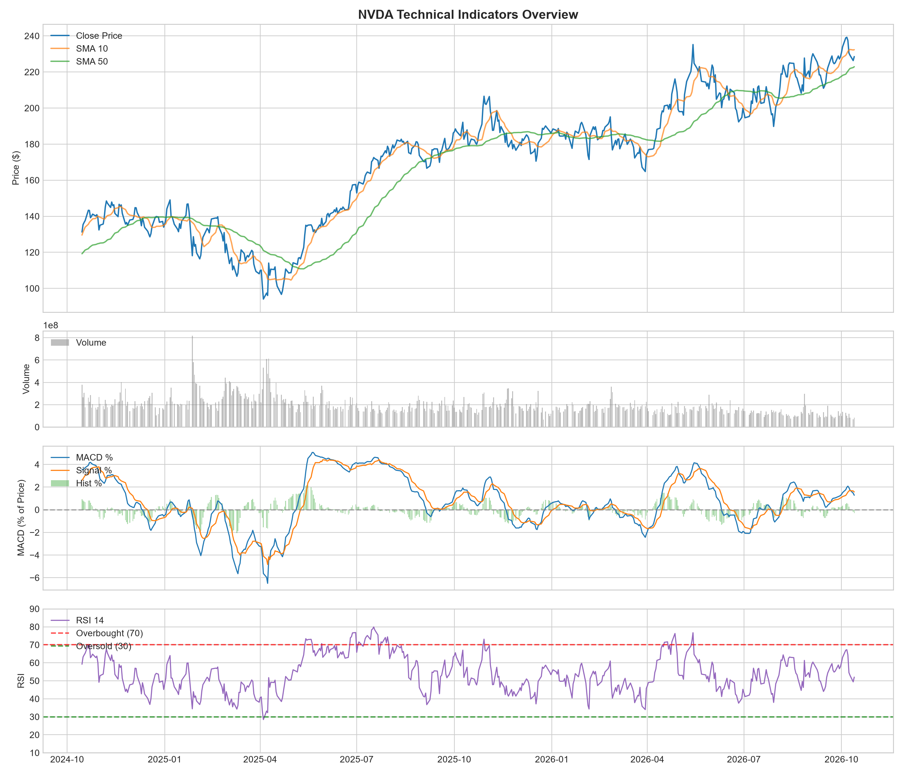

# Quantitative Stock Price Prediction & Algorithmic Strategy Backtesting

[](https://www.python.org/downloads/)
[](https://opensource.org/licenses/MIT)
[](https://github.com/psf/black)
[](https://xgboost.readthedocs.io/)

A modular, production-ready quantitative finance system for:
1. Automated ingestion of daily OHLCV equity data with local caching.
2. Engineering 30+ stationary technical indicators without look-ahead bias.
3. Chronological time-series train/val/test validation with zero future data leakage.
4. Model training and champion selection (`Ridge Baseline`, `Random Forest`, and `XGBoost`).
5. Next-day return and price forecasting with directional hit rate diagnostics.
6. Simulating realistic algorithmic trading strategies net of transaction costs ($0.10\%$).
7. Generating publication-quality charts and quantitative performance reports.

---

## 📈 Visual Highlights & Diagnostic Charts

### 1. Algorithmic Strategy Equity Curve vs. Benchmark (`NVDA`)
> Simulates an active regime-detection strategy against buy-and-hold, accounting for execution fees and tracking underwater drawdowns.



### 2. Out-of-Sample Price Forecast & Residual Errors
> Forecasts next-day close $\hat{P}_{t+1} = P_t \cdot \exp(\hat{r}_{t+1})$ alongside daily prediction residuals.



### 3. Feature Importance Analysis
> Ranks the top quantitative drivers extracted by the champion tree model.



### 4. Technical Indicators Dashboard
> Multi-panel view of Bollinger Bands, volume dynamics, normalized MACD, and Wilder's RSI (14-day).



---

## 📌 Project Architecture

```
stock_prediction_project/
│
├── .github/
│   └── workflows/
│       └── ci.yml            # Automated GitHub Actions test workflow
├── config.py                 # Central parameters, paths, split ratios, fee models
├── data_loader.py            # yfinance fetcher, MultiIndex handler, local caching
├── feature_engineering.py    # 30+ stationary technical indicators & forward targets
├── model_pipeline.py         # Chronological splits, scaler fit/transform, model training
├── evaluate.py               # Statistical evaluation (RMSE, MAE, MAPE, Hit Rate)
├── backtester.py             # Realistic portfolio simulation (PnL, Sharpe, Drawdown)
├── visualizer.py             # Publication-ready Matplotlib visualizer
├── main.py                   # CLI orchestrator running the full pipeline
├── requirements.txt          # Production dependencies
├── LICENSE                   # MIT open-source license
├── .gitignore                # Production Python/ML git ignore rules
│
├── data/                     # Cached historical OHLCV data (.csv)
├── saved_models/             # Persisted models & scalers (.joblib)
├── plots/                    # Output visual charts (.png)
└── reports/                  # Detailed performance evaluation and backtest reports (.txt)
```

---

## 🔬 Quant Rationale & Methodology

### 1. Stationarity vs. Raw Price Levels
Standard machine learning models trained on raw stock prices (e.g., $\$100-\$150$) fail to generalize when asset prices enter new regimes (e.g., $\$250+$). This pipeline transforms all price-level indicators into scale-invariant, stationary metrics:
* **Distance to Moving Averages:**
  $$\text{Dist\_SMA\_50}_t = \frac{\text{Close}_t}{\text{SMA}_{50, t}} - 1.0$$
* **Normalized MACD:**
  $$\text{MACD\_Norm}_t = \frac{\text{EMA}_{12, t} - \text{EMA}_{26, t}}{\text{Close}_t}$$
* **Normalized ATR & Volatility:** Expressed as a percentage of price and annualized standard deviation.

### 2. Elimination of Look-Ahead Bias
* Every feature at index $t$ uses exclusively information known at or before market close on date $t$.
* Targets are forward-shifted to prevent leakage:
  $$r_{t+1} = \ln\left(\frac{\text{Close}_{t+1}}{\text{Close}_t}\right), \quad \text{Direction}_{t+1} = \mathbb{I}(r_{t+1} > 0)$$
* The next-day forecasted price is derived mathematically:
  $$\hat{P}_{t+1} = \text{Close}_t \cdot \exp(\hat{r}_{t+1})$$

### 3. Chronological Time-Series Validation
* **Strict Temporal Splitting:** 70% Train, 15% Validation, and 15% Out-of-Sample Test.
* **Scaler Isolation:** `StandardScaler` is fitted solely on the training partition and transforms validation and test partitions.

---

## 🛠️ Installation & Setup

### Prerequisites
* Python 3.10+
* Windows, macOS, or Linux

```bash
# 1. Clone the repository
git clone https://github.com/<your-username>/<your-repo-name>.git
cd <your-repo-name>

# 2. Create a virtual environment
python -m venv .venv

# 3. Activate the environment
# On Windows (PowerShell):
.\.venv\Scripts\Activate.ps1
# On macOS/Linux:
source .venv/bin/activate

# 4. Install dependencies
pip install -r requirements.txt
```

---

## 🚀 Usage Guide

### Run with Default Settings (`AAPL`)
```bash
python main.py
```

### Run for Any Ticker (e.g., `NVDA`, `MSFT`, `TSLA`, `SPY`)
```bash
python main.py --ticker NVDA --start 2020-01-01
```

### Customize Capital, Date Range, & Bypass Cache
```bash
python main.py --ticker MSFT --start 2019-01-01 --capital 25000 --force-reload
```

### CLI Arguments Reference
| Argument | Type | Default | Description |
| :--- | :--- | :--- | :--- |
| `--ticker` | `str` | `AAPL` | Stock symbol to analyze and trade |
| `--start` | `str` | `2018-01-01` | Historical start date (`YYYY-MM-DD`) |
| `--end` | `str` | `None` | End date (`YYYY-MM-DD`, default: today) |
| `--capital` | `float` | `10000.0` | Initial trading capital in USD |
| `--force-reload` | `flag` | `False` | Forces fresh download from Yahoo Finance |
| `--no-plots` | `flag` | `False` | Skips generating graphical visual plots |

---

## 📤 How to Upload to GitHub

Follow these steps to push this folder to your GitHub account:

### Step 1: Create a New Repository on GitHub
1. Go to [github.com/new](https://github.com/new).
2. Name your repository (e.g., `stock-price-prediction-quant`).
3. Leave **"Initialize this repository with a README"** **UNCHECKED** (we already have a complete README).
4. Click **Create repository**.

### Step 2: Push Your Local Code
Run these commands in PowerShell or your terminal inside the project directory:

```bash
# Verify your local git status
git status

# Add your GitHub remote URL (replace with your repo URL)
git remote add origin https://github.com/<YOUR-USERNAME>/<YOUR-REPO-NAME>.git

# Push to the main branch
git branch -M main
git push -u origin main
```

---

## 📄 License
This project is licensed under the [MIT License](LICENSE).
